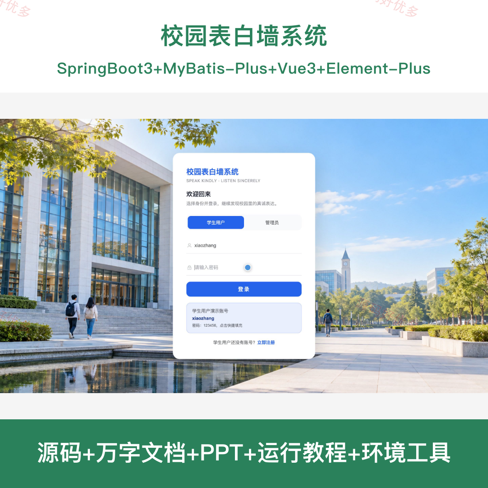
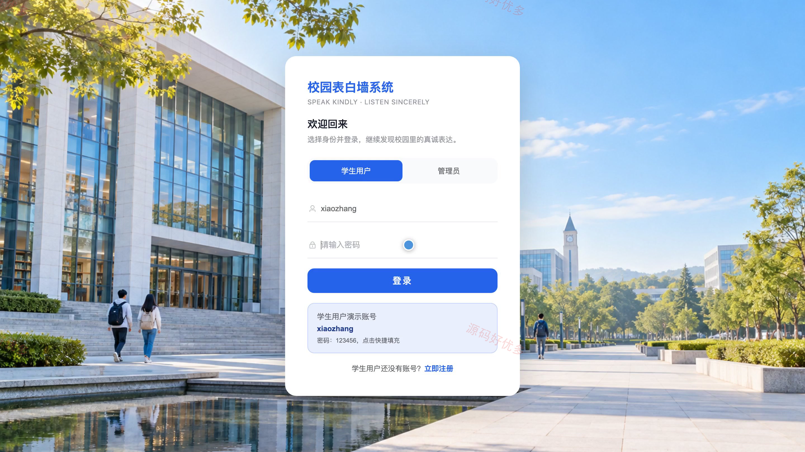
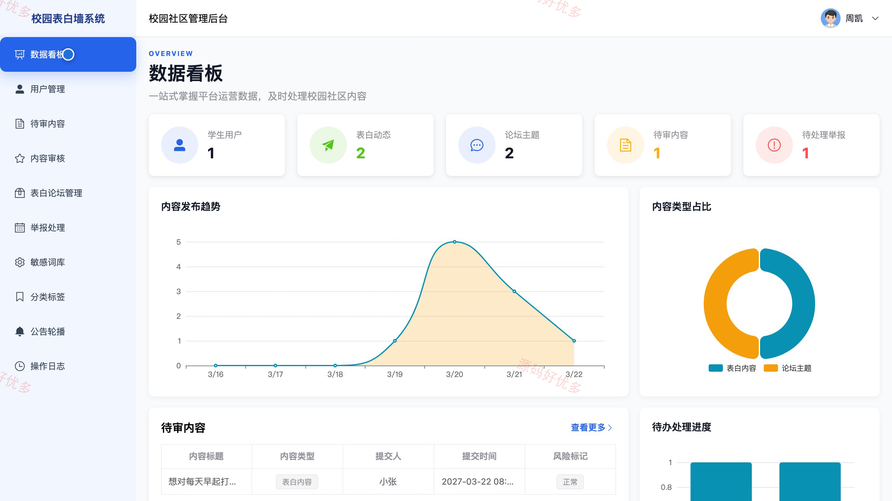
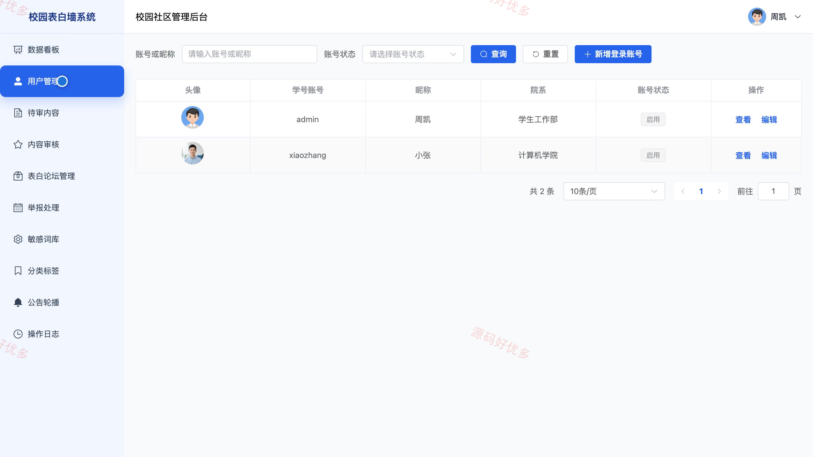
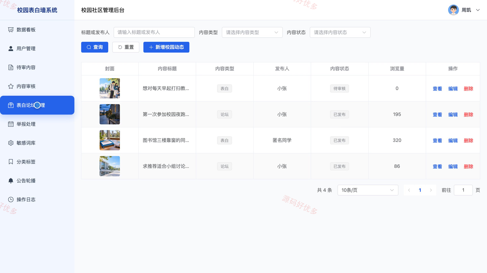
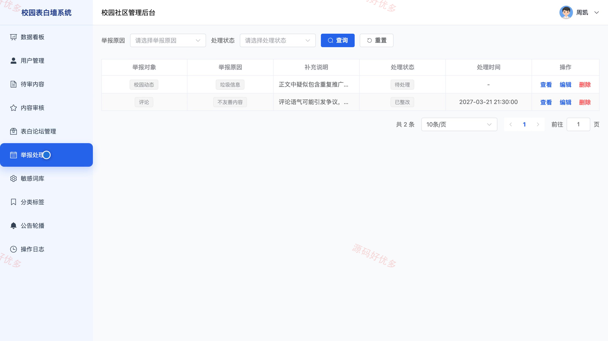

## 源码问题查看主页咨询

### 一、关键词
校园表白墙、校园社区、校园论坛、匿名表白、校园互动

### 二、作品包含
源码+数据库+万字设计文档+PPT+全套环境和工具资源+本地部署教程

### 三、项目技术
前端技术： Html、Css、Js、Vue3.4、Element-Plus
后端技术：Java、SpringBoot3.2.0、MyBatis-Plus

### 四、运行环境要求
开发工具：IDEA/eclipse + VSCODE

数据库：MySQL5.7+（共13张表）

数据库管理工具：Navicat10以上版本

环境配置软件： JDK17 + Maven3.6

前端Nodejs：16+

浏览器：谷歌浏览器

### 五、项目介绍
项目编号：bs138A

校园表白墙系统面向学生交流与校园内容管理。学生可浏览和发布表白及论坛话题，参与评论、点赞、收藏和举报，并在个人中心查看动态与通知；管理员负责内容审核、举报处理、分类维护和运营统计。

角色：用户、管理员

用户功能：注册登录与个人资料维护、浏览表白和校园论坛话题、发布表白和交流帖、评论回复与互动讨论、点赞收藏及取消互动、举报不当内容并查看处理结果、查看我的动态和审核状态、接收审核及回复通知。

管理员功能：学生账号管理、表白和论坛内容审核、评论审核与内容下架、举报处理、敏感词库维护、分类标签及公告轮播维护、数据看板统计、操作日志查询。

### 六、运行截图

